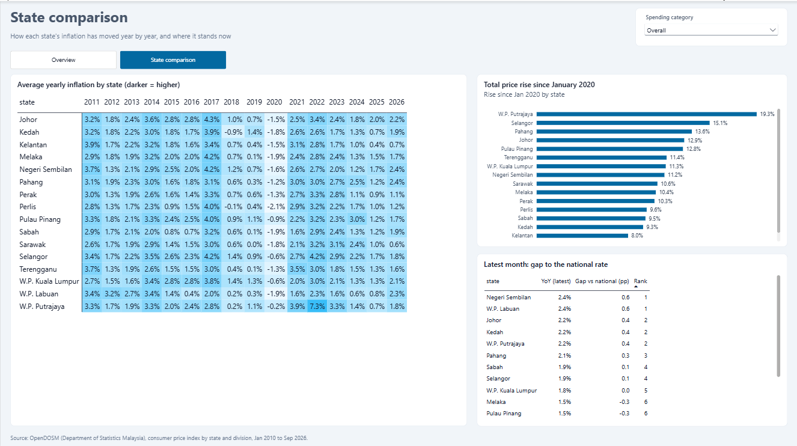
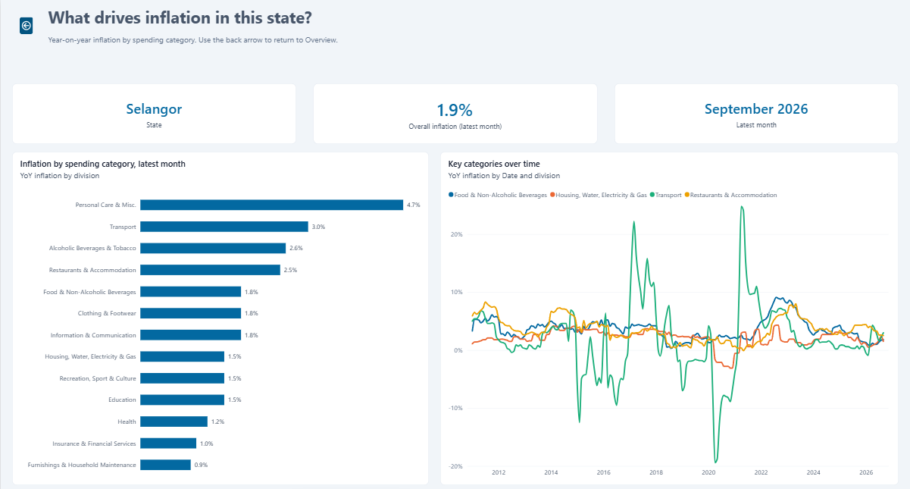

# Malaysia Inflation by State: Power BI Dashboard

**Question:** Where in Malaysia are prices rising fastest, and which spending categories are driving it?


**[Open the live interactive report](https://app.powerbi.com/view?r=eyJrIjoiZmZjNDg2ODItNzJhMy00OTllLWJmNTYtM2Q5MDg4YWFiMGQxIiwidCI6ImNkY2JiMGUyLTlmZWEtNGY1NC04NjcwLTY3MjcwNzc5N2FkYSIsImMiOjEwfQ%3D%3D)** (Power BI, no sign-in needed)

**[Ask the AI about Malaysia's economy](https://malaysia-economic-ai-assistant.streamlit.app/)**: a companion chatbot that answers questions in English or Malay from Bank Negara reports and this CPI data, with page citations ([code](https://github.com/szal31/Malaysia-Economy-AI-Assistant-using-RAG)). The dashboard links to it with a button on each page.

## Key findings (CPI, September 2026)
1. **National inflation is 1.8% YoY**, but the spread between states is wide: **from 0.5% in Sarawak to 2.4% in Negeri Sembilan and Labuan**.
2. **Since January 2020, prices in Putrajaya are up 19.3%** (the highest), followed by Selangor at 15.1%. Labuan (7.7%) and Kelantan (8.0%) rose least.
3. **The top drivers right now are alcohol & tobacco and personal care (2.8% each), then transport (2.5%)**. Clothing (0.2%) and furnishings (0.3%) are almost flat.
4. Since 2010, national inflation peaked at **4.9% in March 2017**, just above the 2022 post-pandemic peak of 4.7% (August 2022).

## Dashboard pages
| Page | Answers |
|---|---|
| Overview | Headline rate, highest-inflation state, state ranking against the national rate, trend over time |
| State comparison | Year-by-state heatmap, cumulative rise since 2020, gap vs national |
| Category drill-through | Which categories drive inflation in a chosen state (right-click a state's bar on Overview) |





## Data
[OpenDOSM](https://open.dosm.gov.my/) consumer price index by state and by COICOP division, monthly from 2010 to September 2026. The national series is included as a benchmark. 47,838 rows.

## Method
| Step | File | What it does |
|---|---|---|
| 1 | `prepare.py` | Merges the index and inflation files, adds national rows, builds a star schema (`fact_cpi`, `dim_state`, `dim_division`), and checks that DOSM's YoY figures match the index |
| 2 | `powerbi/power_query.m` | Loads the CSVs with explicit types, using a folder parameter |
| 3 | `powerbi/measures.dax` | Date table plus measures: YoY via `DATEADD`, state rank via `RANKX`, gap vs national, cumulative rise, top state via `TOPN` |
| 4 | `powerbi/Malaysia-inflation.pbip` | The report as a Power BI Project (text files: TMDL model + PBIR pages), so every change is reviewable in Git |
| 5 | `powerbi/build_report.py` | Generates the three report pages (Overview, State comparison, Category drill-through) as PBIR files |
| 6 | `powerbi/BUILD_GUIDE.md` | Visual-by-visual guide for building the same report by hand |

Power BI skills used: star schema modeling, Power Query (M), DAX time intelligence, `RANKX` / `TOPN`, drill-through, conditional formatting, dynamic titles, a custom report theme (`powerbi/theme.json`) and page navigation.

## Run it
```bash
pip install pandas
python prepare.py
```
Then open `powerbi/Malaysia-inflation.pbip` in Power BI Desktop. If you cloned the repo to a different folder, change the `DataFolder` parameter (Transform data → Manage Parameters) to your `data\clean\` path and click **Refresh**.

To rebuild the report pages from code, close Power BI and run `python powerbi/build_report.py`.

To refresh with new months, re-download the 4 CSVs from `https://storage.dosm.gov.my/cpi/` (`cpi_2d_state`, `cpi_2d_state_inflation`, `cpi_2d`, `cpi_2d_inflation`) into `data/raw/`, rerun `prepare.py`, and click **Refresh** in Power BI.
